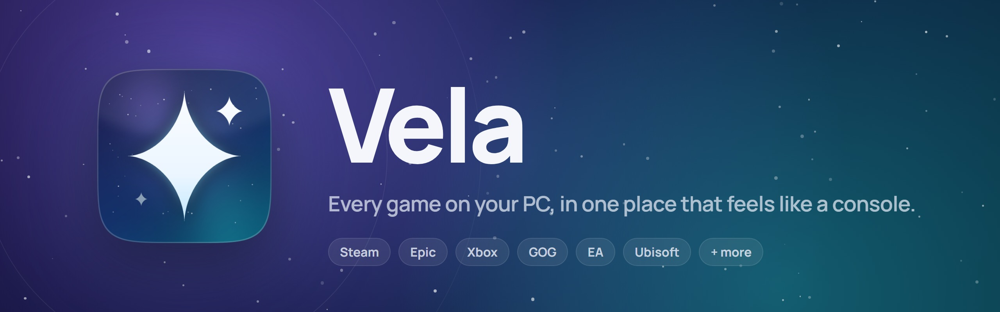
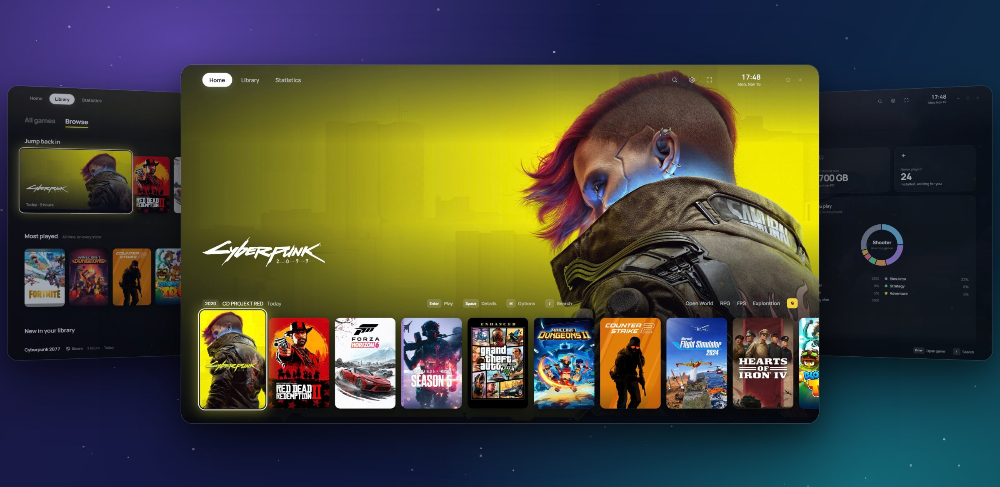
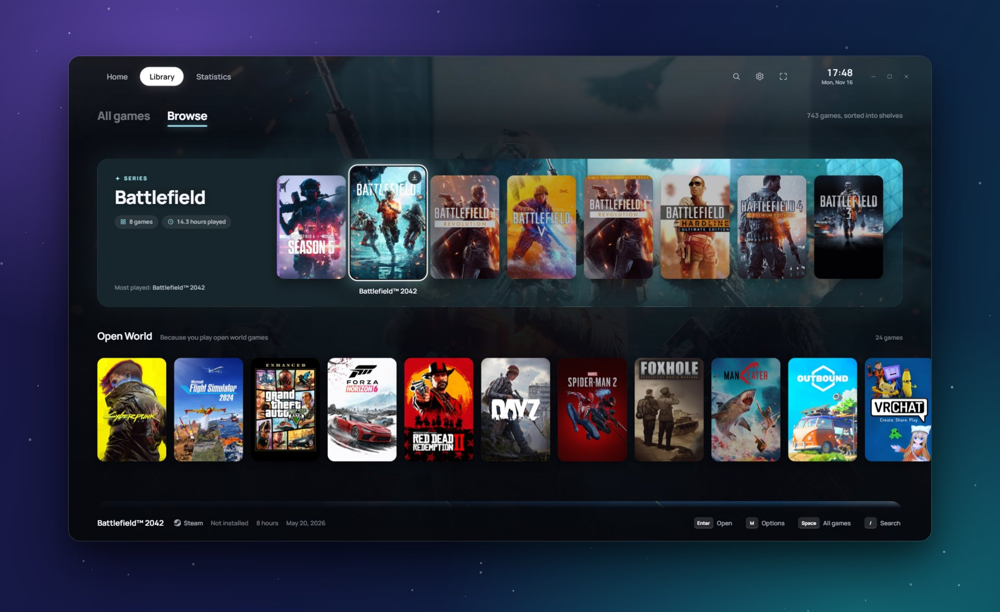
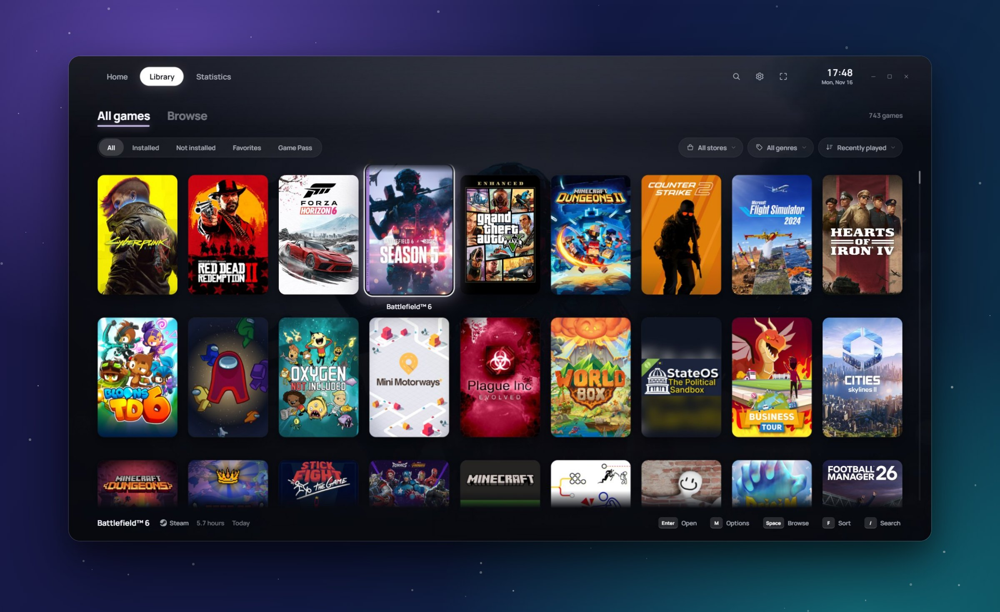
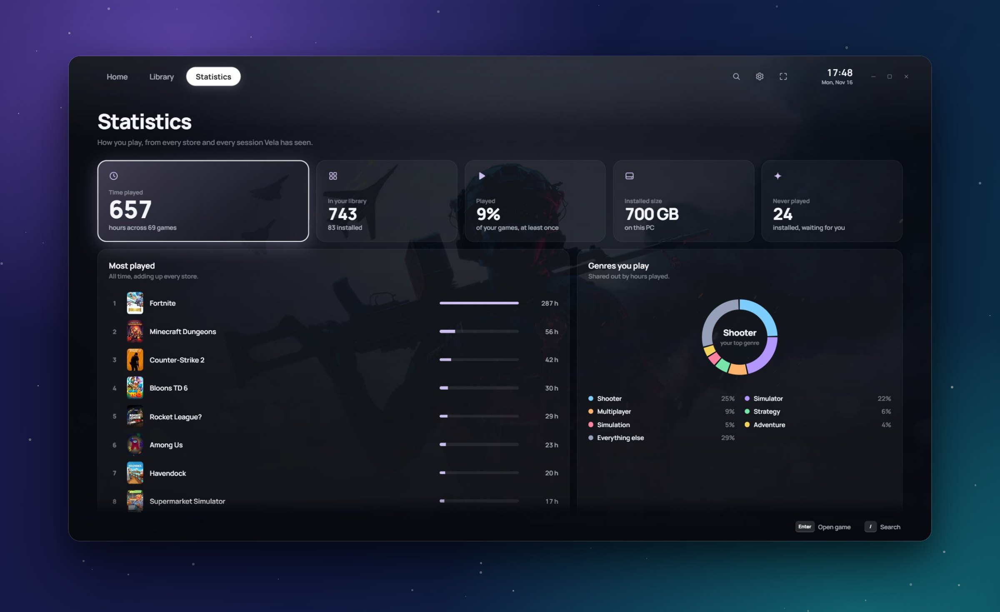
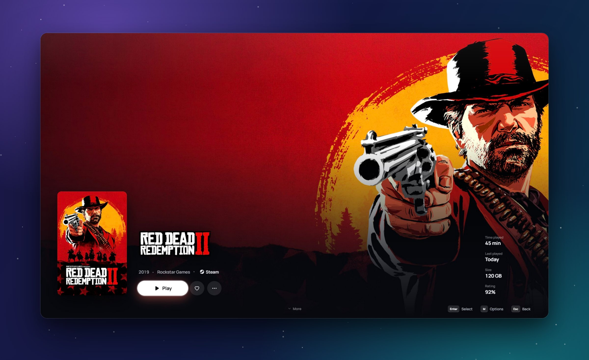
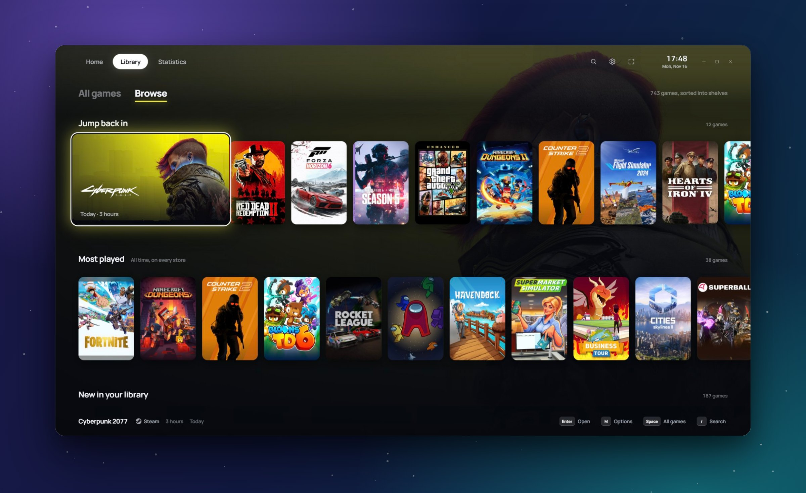
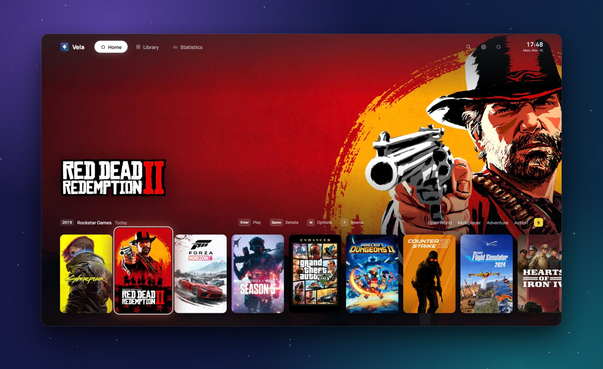

  

  <a href="../../releases/latest"><b>Download for Windows</b></a>

  <a href="#what-you-get">What you get</a>
  &nbsp;·&nbsp;
  <a href="#getting-around">Controls</a>

 

  

Your games live in six launchers that all want to be opened first. Vela reads every one of them and puts
everything on one screen: Steam, Epic, the Xbox app, GOG, EA, Ubisoft, Battle.net and the rest, plus the stray
folder of games that never had a launcher at all. It plays just as well with a mouse at your desk as with a
controller from the couch.

It doesn't try to replace those launchers. They still download, update and sign you in. Vela is the front door.

## What you get

**Home.** Your most recent games in one row, with each game's own artwork filling the screen behind it and its logo
above. Press Play and Vela starts the game, gets out of the way, and comes back when you're done.

**The Library, two ways.** *All games* is the full grid, with filters for installed, favorites and Game Pass, plus
store, genre, collection and eight sort orders. *Browse* turns the same library into shelves, worked out from what
you actually play: what you were last playing, your most played, your genres, and games you installed and never
started. When it spots a series, like four Battlefields or every Minecraft, that series gets a panel of its own, in
its own art and colors. Click the Library tab again to switch between the two.

  

**Statistics.** Hours played across every store, your most played games, the genres your time goes to, when in the
week you play, how your library has grown, your biggest installs, and how full your drives are. Store playtime
counts too, so it fills in from the first launch.

<table>
  <tr>
    <td width="50%"></td>
    <td width="50%"></td>
  </tr>
  <tr>
    <td width="50%"></td>
    <td width="50%"></td>
  </tr>
</table>

**Full screen that feels like a console.** Press F11 and the screen goes dark, Vela's mark comes up with a swell of
sound, and the interface opens around you. In full screen, Back on Home brings up a small menu for sleep, restart,
going to the desktop or leaving full screen. Pick which monitor it uses in Settings.

  

**The small things.**
- Game pages with descriptions, screenshots, playtime and install size.
- Search that matches names, initials ("gta"), developers, publishers and genres.
- Collections you make yourself, which show up as a filter and as shelves.
- Rename any game, or give it your own cover, background or logo.
- Uninstall from the game's menu. Xbox games are removed directly; other stores open their own uninstaller.
- Download progress on a game's cover while Steam installs it.
- An on-screen keyboard whenever a controller needs to type.
- Xbox Game Pass: tell Vela which plan you have and it shows that plan's PC catalog, ready to install. Vela only
  asks if you have a Game Pass game installed.
- Ten accent colors or one that follows each game's art, three background styles, cover size and corner shape, the interface's overall size,
  interface sounds, reduced motion, and swapped A/B for players used to the other side.

## Where it finds games

| Store | What Vela reads |
| --- | --- |
| Steam | Every library folder, playtime and last played, download progress, and non-Steam shortcuts you've added |
| Epic Games | Installed games from the launcher's manifests |
| Xbox app and Microsoft Store | Installed packages, including Game Pass games |
| GOG Galaxy | Its own games, plus what Galaxy knows about your other connected stores |
| EA app, Ubisoft Connect, Battle.net | Installed games |
| Riot, Rockstar, Amazon Games, itch.io | Installed games |
| Anything else | Folders on your drives that look like a game: engine files, game middleware, a real executable. Add your own folders, or add a game by hand |

Copies of the same game on two stores share one tile, and Vela launches whichever copy is installed.

## Getting started

1. Download `Vela_x.y.z_x64-setup.exe` from the [latest release](../../releases/latest).
2. Run it. It installs for your Windows account only, so it doesn't ask for admin rights.
3. Windows may say it "protected your PC", because the installer isn't code-signed. Choose **More info**, then
   **Run anyway**.

Vela needs Windows 10 or 11 (64-bit) and Microsoft's WebView2, which Windows 11 already has. If it's missing, the
installer fetches it.

On first launch Vela asks before going online for artwork. Say no and everything still works; games just get
plain posters.

## Getting around

| | Keyboard | Controller |
| --- | --- | --- |
| Move | Arrow keys | D-pad or left stick |
| Select / play | Enter | A |
| Back | Esc | B |
| Game details, or switch Library view | Space | X |
| Search | / or Ctrl+F | Y |
| Options for the selected game | M | Menu |
| Sort the library | F | View |
| Switch tabs | Q / E or Tab | LB / RB |
| Page up and down | Page Up / Page Down | LT / RT |
| Full screen | F11 | |

With an Xbox controller, the Guide button brings Vela back while you're in a game. That's on by default and can be
turned off in Settings.

## Privacy

Vela has no accounts, no analytics and no telemetry. Everything it knows lives in `%LOCALAPPDATA%\com.vela.launcher`,
and the uninstaller offers to delete it.

With online artwork turned on, it sends game titles to the Steam store and Microsoft's product catalog to find
covers, logos and details, using your Windows region. It also downloads Microsoft's public Game Pass lists. That's
the whole list. Turn online artwork off in Settings, Library and nothing leaves your PC.

## Known rough edges

- Windows only. Vela leans on Windows for finding, launching and removing games.
- The installer isn't code-signed yet, hence the SmartScreen warning.
- "When you play" in Statistics only counts sessions started through Vela, so it starts empty.
